# Colony Doctor

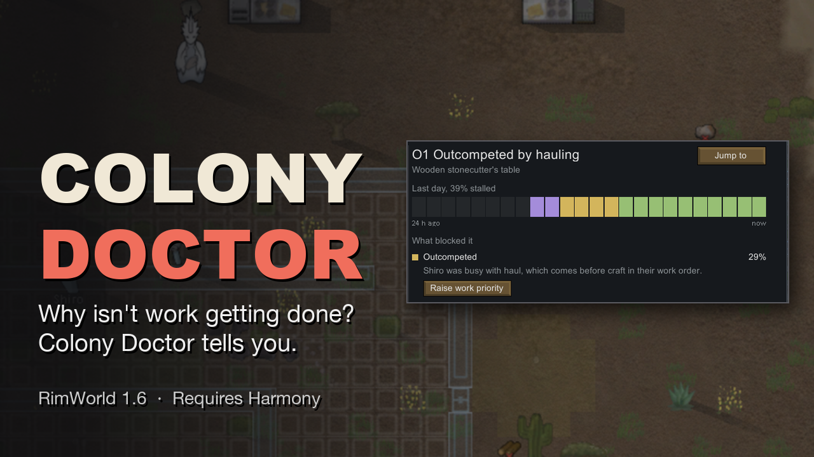

**Why isn't work getting done? Colony Doctor tells you.** A RimWorld mod.

You queued the bill three days ago. The room is still a blueprint, the steel is still lying in the
sun and the field was never sown. Colony Doctor watches the work in your colony over time and tells
you, in plain language, what has been holding each piece up: a bench without power, nobody allowed
to do the work, materials that are missing or out of reach, an allowed area in the way, or
colonists who are always busy with something they rank higher.

RimWorld already knows many of these reasons, but it only shows them for one colonist at one moment,
when you right-click. Colony Doctor keeps track of them, so you see "stalled 70% of the last day,
mostly because of missing steel", not just "blocked right now". For common causes it offers a
one-click fix, which you confirm first and can undo.

## Features

### The Bottlenecks tab
A new main tab lists everything that's stalled, worst first, in eight categories: **Bills**,
**Construction**, **Idle colonists**, **Hauling**, **Growing**, **Orders**, **Patients** and
**Research**. Pick the **last hour**, **last day** or **last quadrum**. Each row shows what's
stalled, where it is, the main reason and how much of that time it was stalled.

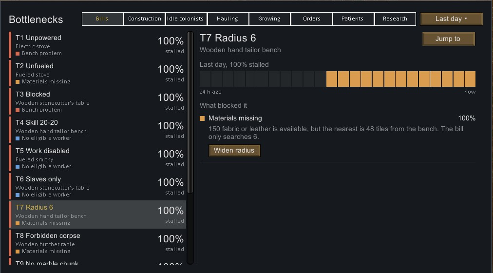

### Why, in plain language
Select a row to see a timeline coloured by reason, a breakdown of what blocked it, and an explanation
for each reason, such as "The electric smithy has no power.", "Nobody has Crafting enabled in the
Work tab." or "150 fabric or leather is available, but the nearest is 48 tiles from the bench. The
bill only searches 6." **Jump to** takes the camera straight to the bench, site, field or colonist.

The reasons, in the order you'd fix them:
- **Bench problem:** no power, out of fuel, broken down, the work spot is blocked, or no one can
  reach the bench.
- **No eligible worker:** nobody has the work type enabled or is capable of it, the bill's worker
  restriction or skill range excludes everyone, the skill needed is too high, an allowed area keeps
  everyone away, or everyone who could do it is downed, drafted or having a mental break.
- **Blocked:** a plant, item, building or rock is in the way of a construction site, the targets are
  forbidden, or a patient isn't in bed.
- **Materials missing:** none on the map, excluded by the bill's filter, forbidden, outside the
  ingredient radius, reserved by someone else, or unreachable.
- **No storage:** nothing accepts the item, or every storage that does is full.
- **Outcompeted:** someone could do it, but they spent the time on work they rank higher. Colony
  Doctor names them and the work, for example "Shiro was busy with haul, which comes before craft
  in their work order."
- **Waiting for a worker:** nothing blocks it, but everyone was off duty or busy with other work
  of the same rank.

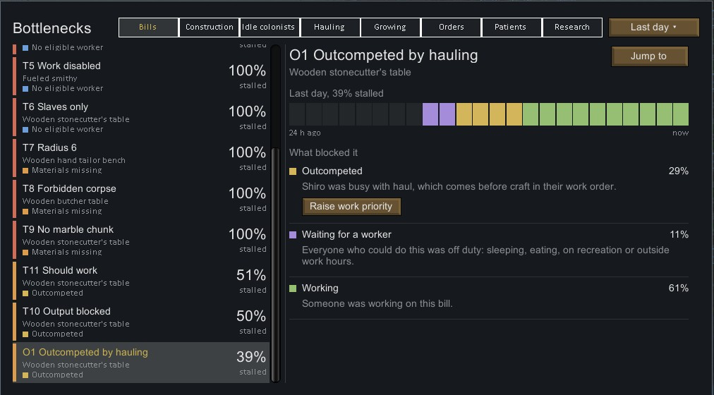

### One-click fixes, with undo
For common causes, a fix button sits right under the reason. Nothing changes until you confirm, and
the dialog says what will change and what it costs. Afterwards the row is marked **Monitoring**
until the work gets going, and **Undo** puts everything back.

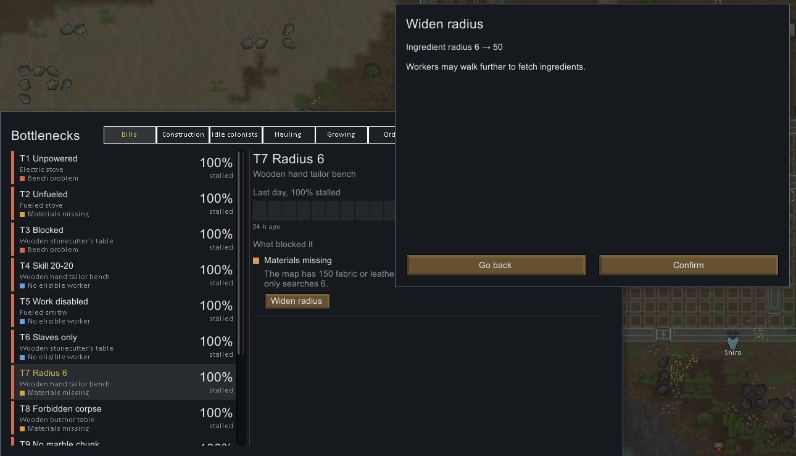

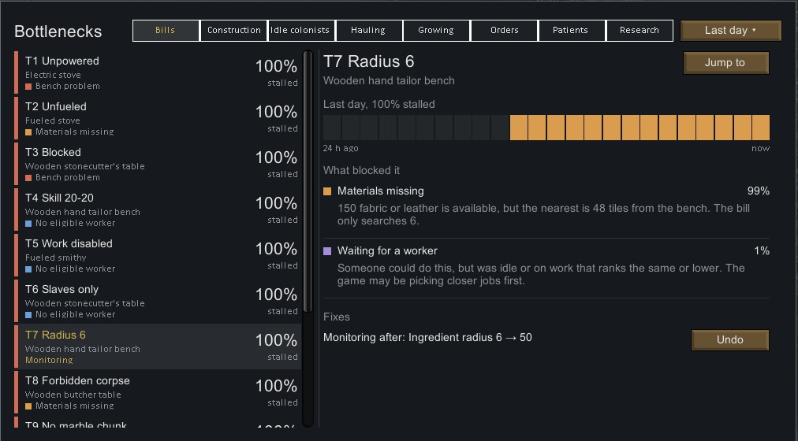

Fixes include: widen the ingredient radius or skill range, allow any worker, unforbid materials,
targets or a bench, allow an item in a stockpile, drop products on the floor, raise a colonist's
work priority, and let a colonist go anywhere when their allowed area is in the way. Each fix only
changes a setting you could change yourself in the game's own windows.

### Construction sites
Blueprints and frames that touch are grouped into one site, so a planned room shows up as one row
("Granite wall ×14, wooden door ×1"), with how many pieces are left and why each is waiting.

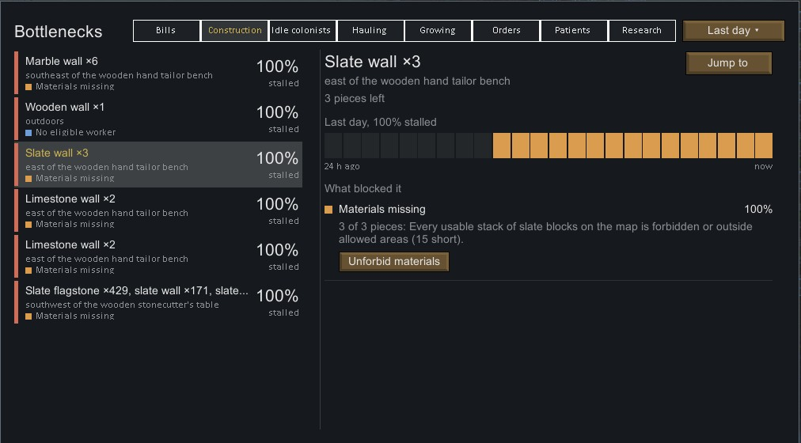

### Hauling backlog
Items lying around for over an hour, grouped by kind ("Steel ×340"): how long the oldest has
waited, how many stacks will rot within a day, and why nobody hauls them.

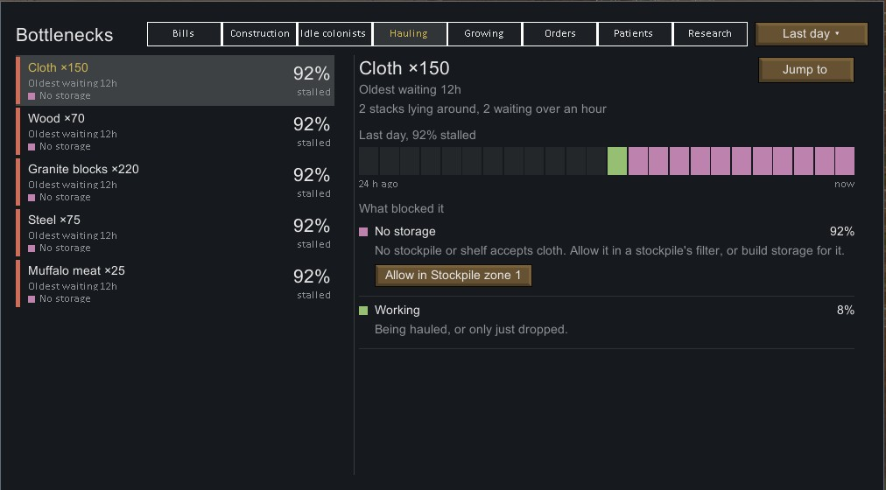

### Growing
Every growing zone and hydroponics basin with cells waiting to be sown or plants ready to harvest:
no power, the crop needs more Plants skill than anyone has, no grower available, out of reach, or
outcompeted. Out of season doesn't count as stalled.

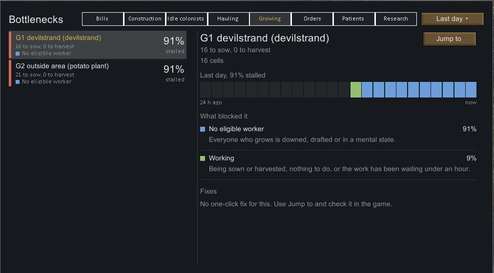

### Orders
Mining, cutting, harvesting, deconstruction, uninstalling, smoothing, hunting, taming and slaughter
orders, one row per order type. Hunting knows when no hunter carries a ranged weapon; taming knows
the Animals skill the animal needs.

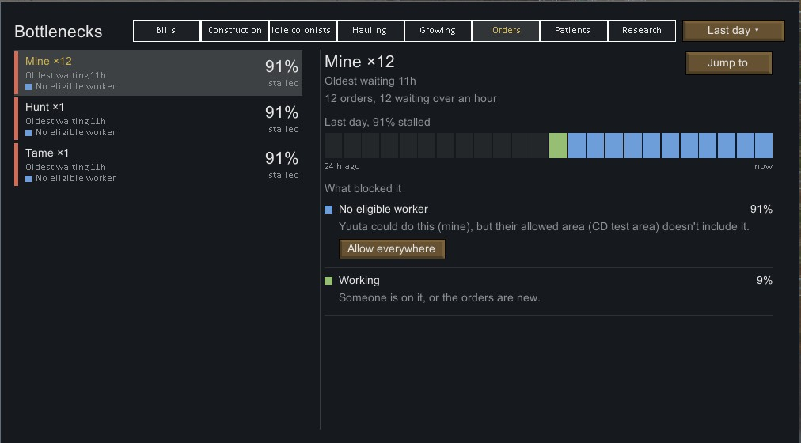

### Patients
Colonists, slaves and prisoners who need tending and aren't getting it: medical care set to "No
care", not lying in bed, no doctor available or able to reach them, or doctors busy with something
else. Bleeding patients show how long they have left.

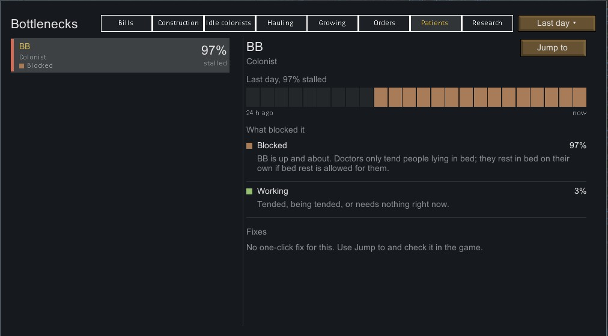

### Research
The current project: no bench it can be researched at (for example a hi-tech research bench), a
missing multi-analyzer, an unpowered or forbidden bench, no researcher available, or researchers
busy with other work.

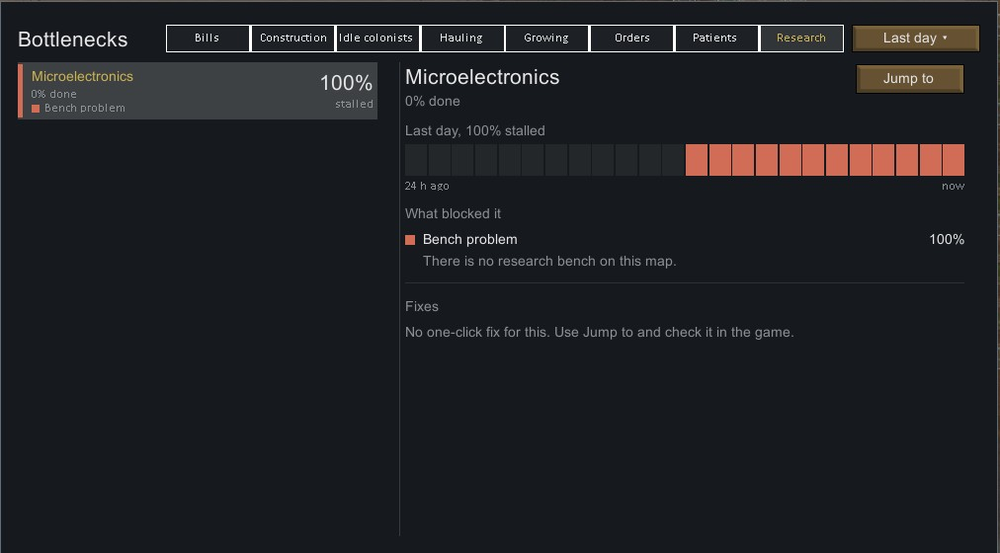

### Idle colonists
Who stands around while on duty, and why: nothing they're allowed to do, all their work blocked
(and by what), or work they didn't take.

### Alerts
**Bills stalled**, **Construction stalled**, **Colonists idle**, **Hauling stalled**, **Food rotting
uncollected** and **Patients untended** appear on the right when something has been stuck for a
while. Click one to open the tab on that category.

## Install

You need **RimWorld 1.6** and **[Harmony](https://steamcommunity.com/sharedfiles/filedetails/?id=2009463077)**.
No DLCs are needed.

1. **Get the mod.** Subscribe on the Steam Workshop, or download the mod zip from
   [Releases](https://github.com/Tw1stedGene/colony-doctor/releases) and unzip it into your RimWorld
   `Mods` folder.
2. **Enable it.** In RimWorld, open **Mods**, turn on **Harmony** and **Colony Doctor** (Colony
   Doctor below Harmony), and restart when asked.

## Getting started

1. **Load any colony.** New or existing, it doesn't matter.
2. **Let the game run for a while.** Colony Doctor starts watching as soon as the map loads. History
   is kept in memory only, so after loading a save it builds up again from that point.
3. **Open the Bottlenecks tab** in the bar at the bottom of the screen, or click one of its alerts.
4. **Pick a row, read why, and fix it:** with the fix button when there is one, or after **Jump to**
   the way you normally would.

**Settings** (Options → Mod settings → Colony Doctor):
- **Show Colony Doctor alerts:** turns the alerts on or off.
- **Diagnose modded benches:** asks modded benches' own code why a bill can't be done. Without it,
  bills on those benches show as **Unknown**. Always off while the Multiplayer mod is active.

## Safe for your saves

- **Looking is read-only.** Watching and diagnosing never changes your colony. Only a fix you
  confirm changes anything, and only settings you could change yourself.
- **Nothing is written to your save.** You can add or remove it in the middle of a game.
- **Light on performance.** It samples every 250 ticks, spreads the work across ticks and keeps a
  fixed amount of history per item.

## Troubleshooting

- **The tab says "No data yet".** Let the game run unpaused for a little while; the history fills up
  as time passes.
- **History is gone after loading.** That's expected: history isn't saved, and it builds up again
  after a load.
- **A bill shows "Unknown".** The bench uses a modded work giver. Turn on **Diagnose modded benches**
  in the settings (not available with Multiplayer). Some modded benches still can't be explained.
- **No "Raise work priority" button.** It needs manual work priorities (the numbers in the Work tab),
  and it's hidden while the Work Tab mod is loaded.

## Compatibility

- Works with RimWorld 1.6, with or without DLCs. Needs Harmony.
- Safe to add to or remove from an existing save.
- Designed to be Multiplayer-safe: diagnosis never changes game state or uses randomness, fixes are
  sent through Multiplayer's sync, and **Diagnose modded benches** is switched off while Multiplayer
  is active.
- Benches and bills added by other mods are covered when they use the game's normal bill system.
  Others fall back to **Unknown**, or to what the bench's own code reports when **Diagnose modded
  benches** is on.

## Coming next

Planned, not in the mod yet:
- Animal training, food for taming, and animal patients.
- Anomaly research projects.
- Work priority fixes that work with the Work Tab mod.

## Support

Found a bug or have an idea? [Open an issue](https://github.com/Tw1stedGene/colony-doctor/issues).

Colony Doctor is free. If it helps your colony, you can
[buy me a coffee](https://buymeacoffee.com/tw1stedgene).

Want to help build it? See [CONTRIBUTING.md](CONTRIBUTING.md).

## License

MIT, see [LICENSE](LICENSE).

Colony Doctor is a fan project. It is not affiliated with, endorsed by or sponsored by Ludeon Studios.
